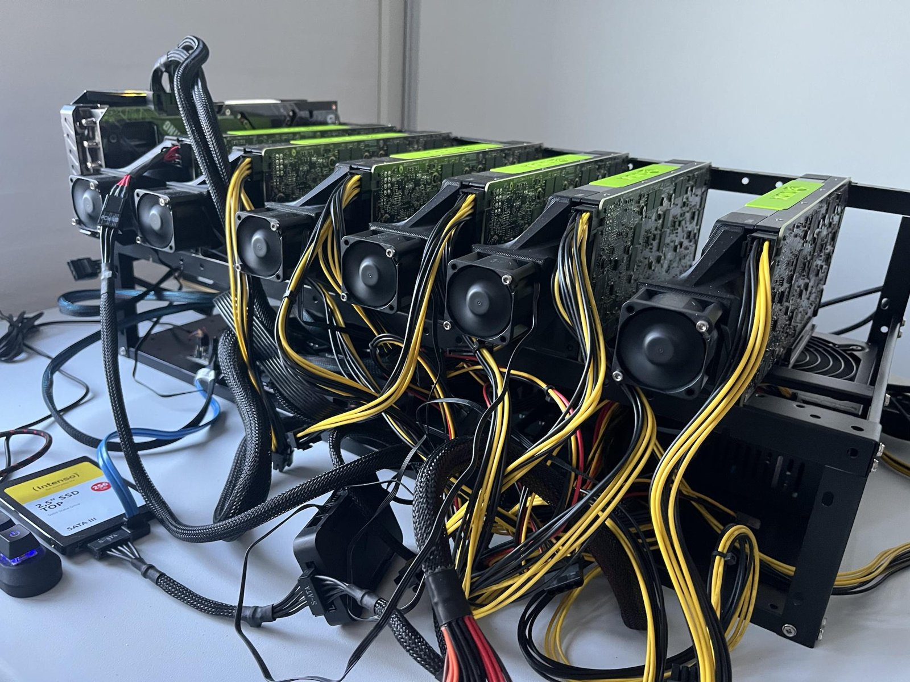
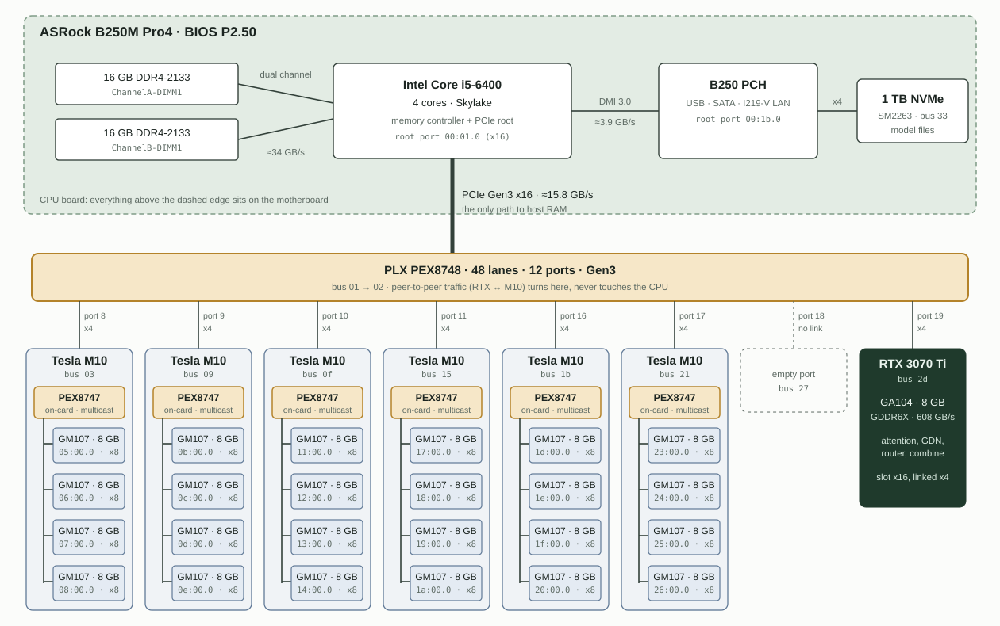

# m10dis

**m10dis** ("M10 distributed") runs **Qwen3.8-Flash-Next-FP8**, a 48-layer mixture-of-experts model with 512 experts per layer, on one consumer GPU plus 24 Maxwell GPUs from 2016:

- **1× RTX 3070 Ti (8 GB)** runs attention, linear attention (GDN), the router and the hyper-connections, all under vLLM.
- **6× Tesla M10 = 24× GM107 (8 GB each, 192 GB total)** hold the routed and shared experts, the n-gram embedding table (PLE) and the LM head, and compute on them.
- Everything hangs off **one PCIe switch** (PLX PEX8748) on a desktop B250 board with a 4-core i5. RTX ↔ M10 traffic goes peer-to-peer through the switch, never through the CPU. Requests reach the four GPUs of a card through **PCIe multicast** in the M10's own PEX8747.

*The final rig. The RTX 3070 Ti is the card at the far left, the only one without a shroud fan attached; the six Tesla M10 cards, each with its fan, sit to its right.*

## Results

| What | Value |
|---|---|
| Decode | **52.5 tok/s** (single stream) |
| Prefill | **≈ 277 tok/s** (pipelined batches of 32 rows, two in flight) |
| Context | 94,631 tokens of KV cache (2.5 GiB, prefix caching off), `max_model_len` 90,112 |
| MMLU-Redux, 5-shot | **90.98 ± 0.56** on 2,628 of 5,330 questions (official base model: 90.68) |
| LiveCodeBench v6, 40-problem subset | **35/40 = 87.5 % ± 5.2** (easy 10/10, medium 12/12, hard 13/18); 92.1 % of the problems that finished within the 81,920-token cap (official: 91.9) |
| MoE layer, decode | ≈ 150 µs per token per layer (publish 29 + round trip 132 + combine 9 µs) |

Details, method and raw outputs: [docs/RESULTS.md](docs/RESULTS.md) and [results/](results/).

## How it works, in short

1. Each of the 20 routed GM107 holds **32 of the 640 intermediate rows of every expert** of every layer (FP8 + scales, ≈ 6 GB per GPU). A token's 10 experts therefore touch all 20 routed GPUs equally, with no load imbalance.
2. For each MoE layer the RTX writes the hidden state **once per card**. The card's PEX8747 copies the write to its four GPUs (multicast).
3. The resident worker kernels (persistent, polling) compute gate/up/down for their slice. Each card's leader GPU sums its card's partials over on-card peer-to-peer writes.
4. The leaders write their sums back into the RTX's memory through remapped page-table entries, and every worker acknowledges. The RTX combines 5 routed sums plus the shared expert and continues.
5. Prefill sends up to 64 rows per exchange through a host-memory batch area, pipelined as two 32-row slots.

Full description: [docs/ARCHITECTURE.md](docs/ARCHITECTURE.md) and [docs/TRANSPORT.md](docs/TRANSPORT.md).

## Status and warnings

This is a **research system for one specific machine**, published so others can learn from it and adapt it. It is not a turnkey package.

- It needs a **patched Linux kernel** (PCI resource reservation for late-powered cards) and a **patched NVIDIA UVM module** (it lets the RTX write into M10 memory and the M10s write into RTX memory by remapping GPU page-table entries). Both load on the live system and can hang or crash it if misused.
- The runners write switch registers and GPU page-table entries. Every one of them is saved, verified and restored, and the runners check this. Read [docs/RUNNING.md](docs/RUNNING.md) before you run anything.
- The model files, expert bundles and n-gram embedding shards take about 350 GB on fast local disk.
- Tested with Linux 7.0.14, NVIDIA driver 580.178.04, CUDA 12.4 (sm_50 for the M10s), vLLM 0.32.0, PyTorch 2.13 + cu132, Python 3.14.

## Repository layout

| Path | Content |
|---|---|
| `src/` | All runtime code: RTX peer library and vLLM hooks, M10 worker kernels and services, the resident daemon, preparation and benchmark tools. Flat on purpose, because runners locate files next to themselves. [docs/CODE_MAP.md](docs/CODE_MAP.md) lists every file. |
| `transport/` | UVM patches and ABI headers (`driver/`), UVM build and swap scripts, the two small helper kernel modules |
| `kernel/` | PCI quirk patch for late M10 enumeration, GRUB entry template |
| `boot/` | Suspend/resume workflow that powers the late M10 cards and enumerates them |
| `fan/` | M10 fan-bank control: fancontrol config, temperature helpers, patched nct6687 and ARCTIC USB fan controller drivers |
| `docs/` | Architecture, transport, hardware, build, running, interface reference, results, lessons |
| `results/` | Benchmark outputs (per item), scores and the experiment log |
| `prompts/` | Default prompt for the smoke runs |

## Documentation

- [ARCHITECTURE.md](docs/ARCHITECTURE.md): what runs where, and one token's path through a layer
- [TRANSPORT.md](docs/TRANSPORT.md): multicast, page-table remapping, return slots, card-level sums, the exchange modes
- [HARDWARE.md](docs/HARDWARE.md): board, switches, power, the I/O-port-space problem, the late-enable boot, cooling
- [BUILD.md](docs/BUILD.md): kernel, UVM module, worker kernels, RTX library, Python environment
- [PREPARE.md](docs/PREPARE.md): model files, expert bundles, n-gram shards, LM head, topology
- [RUNNING.md](docs/RUNNING.md): boot to first token: late enable, UVM swap, daemon, vLLM, recovery
- [INTERFACE.md](docs/INTERFACE.md): daemon commands, worker modes, environment settings
- [BENCHMARKS.md](docs/BENCHMARKS.md): benchmark mode, item sets, scoring, unattended night runs
- [RESULTS.md](docs/RESULTS.md): throughput, timing breakdowns, accuracy, determinism
- [LESSONS.md](docs/LESSONS.md): what didn't work, and why
- [research/BATCHED_MOE_EXCHANGE.md](docs/research/BATCHED_MOE_EXCHANGE.md): design record of the batched prefill exchange

## License

MIT for the project's own code ([LICENSE](LICENSE)). Kernel, UVM and fan-driver patches keep their upstream licenses ([THIRD_PARTY.md](THIRD_PARTY.md)).
