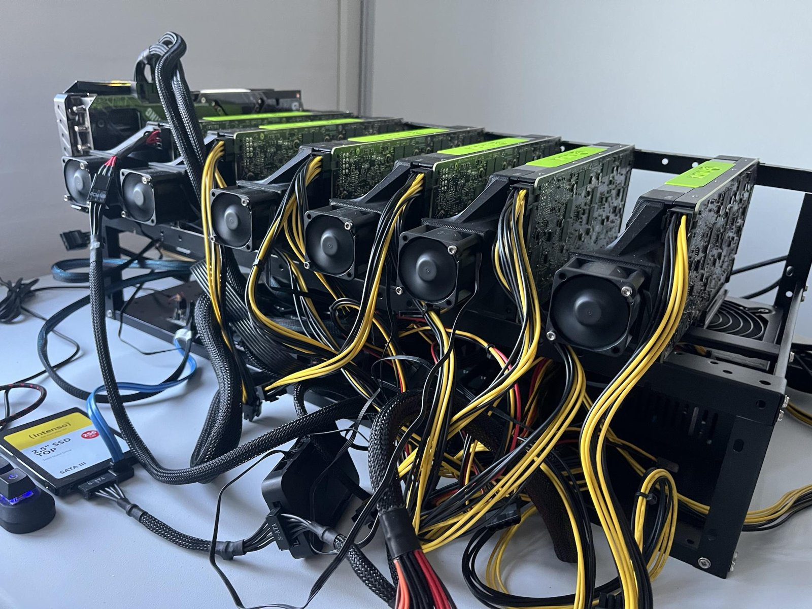
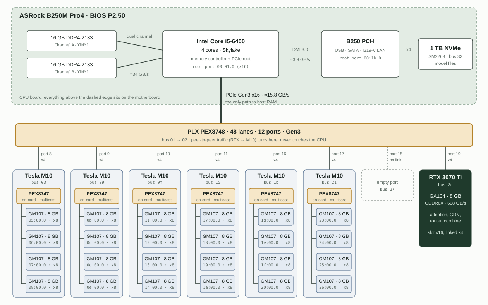

# Hardware

*The final rig. The RTX 3070 Ti is the card at the far left, the only one without a shroud fan attached; the six Tesla M10 cards, each with its fan, sit to its right.*

## Parts

| Part | Details |
|---|---|
| Motherboard | ASRock B250M Pro4, BIOS P2.50 |
| CPU | Intel Core i5-6400, 4 cores; its x16 PCIe port feeds the switch |
| RAM | 2 × 16 GB DDR4-2133, dual channel (≈ 34 GB/s) |
| Storage | 1 TB NVMe on the B250 chipset (models, expert bundles, n-gram shards, caches) |
| PCIe switch | PLX (Broadcom) PEX8748, 48 lanes, Gen3, on the CPU's x16 port; eight x4 downstream ports |
| GPUs | 6 × Tesla M10 (each: on-card PEX8747 + 4 × GM107, 8 GB GDDR5 per GM107), 1 × RTX 3070 Ti 8 GB |
| Power | two PSUs: the board's PSU powers the boot M10 (port 8); PSU2 powers the five late M10 cards |
| Cooling | the M10s are passive cards; six shroud fan banks, see [Cooling](#cooling) |

The PEX8748's downstream ports 8–11 and 16–17 carry the six M10 cards, port 18 is empty and port 19 carries the RTX. Every link is **Gen3 x4**, about 3.9 GB/s, including the RTX, whose slot is x16 but links at x4. The link from the CPU to the switch is Gen3 x16 (≈ 15.8 GB/s). Idle links drop to 2.5 GT/s, so `lspci` shows Gen1 at rest.

Inside each M10, the PEX8747 splits the card's x4 uplink into four x8 links, one per GM107.

### Where the parts came from

| Part | Source |
|---|---|
| PEX8748 switch board | [AliExpress 1005012718883080](https://www.aliexpress.com/item/1005012718883080.html) |
| Risers | [Amazon B0BQ2G38YJ](https://www.amazon.de/dp/B0BQ2G38YJ) |
| Cables | [Amazon B0DWK622D4](https://www.amazon.de/dp/B0DWK622D4) |

### Possible upgrades

- **An x8 riser to the switch.** Every link, including the RTX's, currently runs at x4. A riser that connects at x8 to the switch would make the system a little faster.
- **A seventh M10.** Port 18 of the switch is free, and two spare M10 cards are available. The code currently assumes exactly six cards: `prepare_six_m10_groups.py` requires six groups, and the expert slicing gives 20 routed GPUs 32 of the 640 intermediate rows each. A seventh card needs changes there first.

### GM107 (Maxwell, sm_50)

| Property | Value |
|---|---|
| SMs | 5 |
| FP32 | ≈ 1.67 TFLOPS |
| FP16 / FP8 / INT8 math | none at useful speed (FP16 is not faster than FP32; no tensor cores) |
| FP64 | 1/32 rate |
| Memory | 8 GB GDDR5, 83 GB/s spec, ≈ 43 GB/s achieved by the gate/up kernel |
| BARs | BAR0 16 MB registers, BAR1 256 MB framebuffer aperture, BAR3 32 MB; the I/O BAR5 is suppressed (see below) |
| Clocks | capped by the application-clocks setting at 1137–1189 of 1202 MHz SM, memory 2600 MHz; parked workers idle at 135/405 MHz |

The worker kernels decode FP8 weights in software and accumulate in FP32. Data movement, not math, sets their speed: at 10 blocks per GPU they are latency-bound for single rows.

## Why the cards are powered late

At power-on, the BIOS has to give every PCI bridge on the path to a device a share of the legacy **I/O port space**: 64 KiB in total, handed out in 4 KiB windows per bridge. Each M10 adds a PEX8747 with four downstream bridges, and each GM107 has a 128-byte I/O BAR (BAR5). With six cards the firmware runs out of port space and fails to enumerate the cards, even though there is plenty of memory address space.

The fix has three parts:

1. **Boot with only one M10 powered.** PSU2 stays off, so the BIOS sees one M10 behind port 8 plus the RTX.
2. **Reserve resources for the dark ports.** A kernel quirk (`kernel/m10-late-enable-quirks.patch`) marks the PEX8748 downstream ports in slots 0x09–0x13 as hotplug bridges. The kernel command line gives each hotplug bridge spare bus numbers and memory windows and **no** I/O window (`pci=assign-busses,realloc=on,hpbussize=6,hpiosize=0,hpmmiosize=128M,hpmmioprefsize=2G`). A second quirk drops the GM107's I/O BAR5 and clears its I/O decode. The NVIDIA driver works without it: the GPUs are used through BAR0/1/3 only.
3. **Bring the other cards up through suspend and resume.** Simply switching PSU2 on and rescanning did not reliably initialize the PEX8747 inside a late card: it gave 2 or 3 of 4 GPUs, even with secondary-bus resets and link retraining. Resuming from S3 with PSU2 newly on initializes them cleanly.

### Boot sequence

1. Cold boot with PSU2 off into the `m10late8` GRUB entry. Use `kernel/42_m10_eight_port.template`, which carries the `pci=` parameters. The plain "advanced options" entry for the same kernel doesn't.
2. `sudo boot/prepare-and-suspend.sh`: checks the baseline, removes and isolates the RTX for the sleep, isolates the late ports (found from sysfs by the same slot rule as the quirk), saves bridge registers and enters deep S3. Close `nvtop` and every CUDA client first.
3. While the machine sleeps, switch PSU2 on, wait about 5 s and press the power button once.
4. `sudo boot/resume-and-enumerate.sh`: enables the late branches one at a time, requires exactly four GM107 behind every branch with a link, loads the NVIDIA driver, runs a checked CUDA test on every GPU (`boot/cuda_sanity_all_gpus.cu`) and restarts fan control.

Never switch PSU2 off while the late devices are registered.

After that, the patched UVM module has to be swapped in before any RTX-peer run: [RUNNING.md](RUNNING.md).

## Cooling

Tesla M10s are passive server cards and need forced air through their fins. Six fan banks, one per card, all follow the **hottest** M10, whichever card it is:

- 2 banks on the motherboard's Nuvoton NCT6683 (driver: the patched `nct6687` in `fan/drivers/nct6687/`; never `pwm2`, which is the CPU fan),
- 4 banks on an ARCTIC USB fan controller (driver: `fan/drivers/arctic-fan-controller/`).

`fan/m10-fancontrol.conf` drives all six with the same curve, PWM 20 up to 55 °C rising to PWM 200 at 70 °C. `fan/bin/m10-max-temp` reads the hottest GM107 from `nvidia-smi`. The systemd unit (`fan/m10-fancontrol.service`) sets all fans to full when it stops. `fan/bin/m10-fan-emergency` and `fan/bin/m10-fan-full` do the same by hand.

Installation: `fan/install-m10-fancontrol.sh`. Fan-to-PWM mapping and idle calibration: `fan/probe-m10-pwm-mapping.sh`, `fan/calibrate-m10-idle.sh`.
