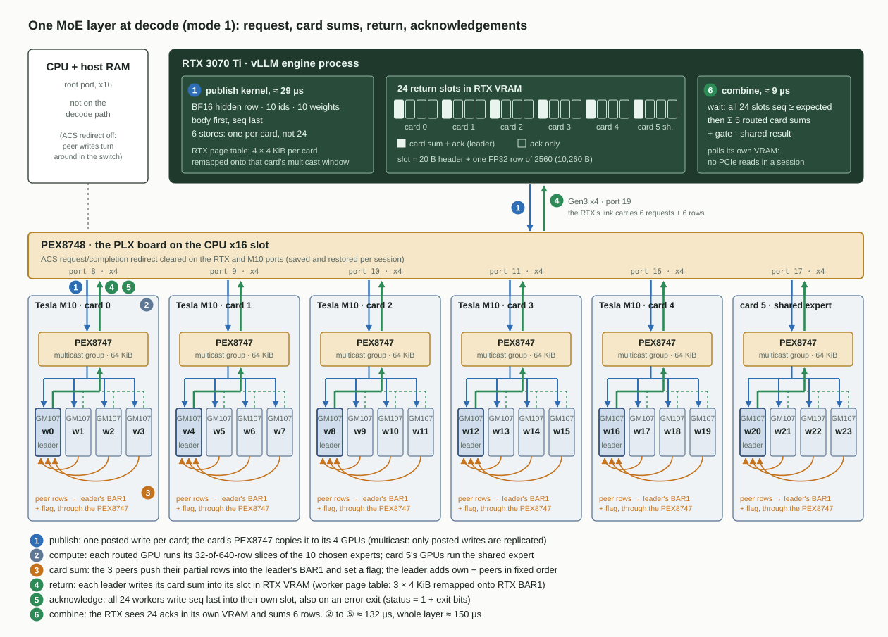
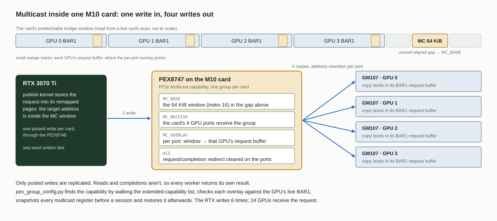
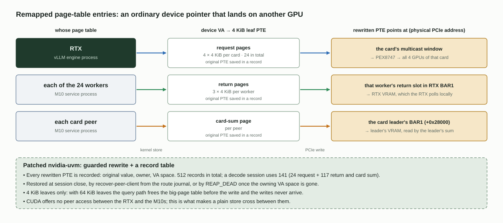
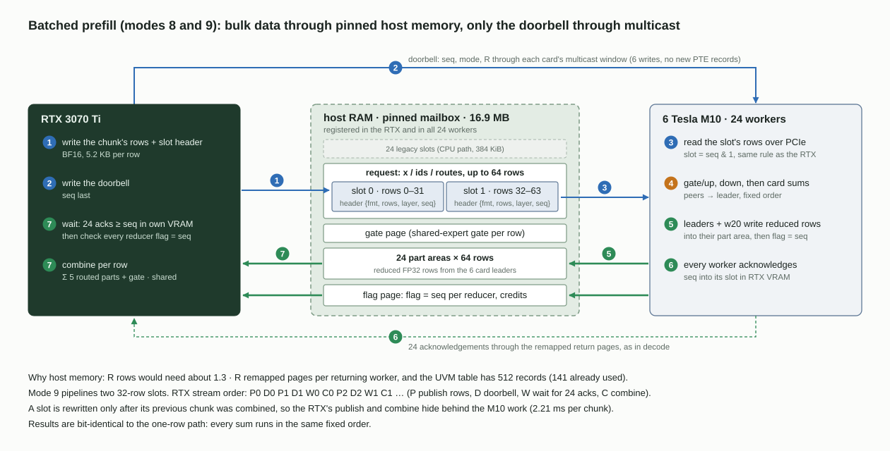

# Transport: how bytes move between the RTX and the M10s

Every exchange follows the same pattern: the RTX **broadcasts** one request, every worker runs the operation on its own resident data and writes its part back, and the RTX **waits** for 24 acknowledgements and **combines** the parts. This page explains the mechanisms underneath. The exact request and result formats per mode are in [INTERFACE.md](INTERFACE.md).

## 1. Peer-to-peer through the switch, with ACS relaxed

All GPUs sit below one PEX8748 (see [HARDWARE.md](HARDWARE.md)). PCIe ACS (Access Control Services) on the switch's downstream ports would normally redirect peer requests up to the CPU's root port. The runner clears only the **request and completion redirect bits** (`PCI_ACS_RR | PCI_ACS_CR`) on the seven PEX8748 ports of the M10 cards and the RTX, and on the 20 PEX8747 GPU ports of the five routed cards (for the card sums). It saves every original value and restores it afterwards (`src/run_qwen38_rtx_local_acs_trial.sh`). With redirection off, an RTX write to an M10 address turns around inside the PEX8748.

## 2. Multicast inside each M10 card

The PEX8747 on every M10 card implements the PCIe **Multicast** capability (an optional part of the PCIe spec). `src/pex_group_config.py` finds the capability by walking the extended-capability list, never at an assumed offset, and configures one group per card:

- a 64 KiB multicast window (`MC_BASE`, index 16), placed in an unused, aligned gap of the card's prefetchable bridge window (`src/prepare_six_m10_groups.py` picks it from a live sysfs scan);
- the card's four GPU ports as receivers;
- a per-port overlay (`MC_OVERLAY`) that redirects the window to a 64 KiB-aligned address inside that GPU's BAR1, where the driver has mapped the worker's request buffer. The script checks the address against the GPU's live BAR1 range.

A posted write into that window is replicated by the switch to all four GPUs. Only posted writes multicast. Reads and completions don't, which is why results come back per worker. The runner snapshots every multicast register before a session, checks them afterwards and restores them (`mc_registers_unchanged` in every run's result).

The RTX therefore writes each request **six times**, once per card, and 24 GPUs receive it.

## 3. Remapped GPU page-table entries (the UVM patches)

CUDA offers no peer access between the RTX and the M10s, so an RTX kernel can't simply store into M10 memory. The patched `nvidia-uvm` (`transport/driver/patches/`) adds a guarded operation that **rewrites a GPU page-table entry** so that a normal device virtual address points at a chosen physical PCIe address:

| Direction | Whose page table | Points at | Leaves |
|---|---|---|---|
| Request (RTX → M10) | RTX | each card's multicast window | 4 × 4 KiB per card |
| Return (M10 → RTX) | each worker | that worker's return slot in RTX BAR1 | 3 × 4 KiB per worker |
| Card sum (M10 → M10) | each peer | the card leader's BAR1 | per peer |

Properties of the mechanism:

- Every PTE it changes is recorded (original value, owner, VA space). It's restored at session close, or by `REAP_DEAD` once the owning VA space is gone. The patched module has a fixed table of **512** such records. A session uses 141: 24 request, 117 return and aggregation.
- Only **4 KiB leaves** work. With 64 KiB leaves the query path frees the big-page table before the PTE write (a bug in the extension), and the writes are never delivered.
- The RTX-side window must be at least 64 KiB, or `ACQUIRE_EXTERNAL_OWNER` fails with `NV_ERR_INVALID_LIMIT`.
- The remapped VA spaces belong to the vLLM engine process. If that process dies without closing, the records stay until a client recovery or `REAP_DEAD`. `VLLM_WORKER_SHUTDOWN_TIMEOUT_SECONDS=120` keeps vLLM from killing the engine before the adapter has closed.

Two small helper modules support this. `transport/rtx_mc_dma/` creates IOMMU/DMA translations for the multicast windows in the RTX's DMA domain, with no traffic and no config writes. `transport/driver/m10_qwen_mc_wc6.c` gives the daemon bounded write-combining CPU mappings of the six multicast apertures.

## 4. Requests and the sequence protocol

The RTX keeps one device-side sequence counter for all operations. A request is written body first and its `seq` last. Workers poll the sequence word in their request page. Posted writes from one source to one destination arrive in order, so a worker that sees the new `seq` also sees the body.

Since 2026-11-05 (mode 10 with the outer group, `Q38_RTX_PEER_PUBLISH_ORDER=4`) one RTX kernel does it all: thread 0 increments the sequence, all threads write the body, each thread fences (`__threadfence_system`), a block barrier, then thread 0 writes `seq`. The mode word is part of the body. Before, three kernels did this (begin, publish, then a separate mode + `seq` write with two fences); merging them saves 4–6 µs per layer (§9).

Workers always take `last + 1`. In mode 9 the doorbell may already show `last + 2`.

## 5. Return slots and acknowledgements

Each worker owns one return slot (`Q38CpuMailboxSlot`, 10,260 B: a 20 B header and one FP32 row of 2560) **in RTX memory**. The RTX therefore polls its own VRAM and never issues a PCIe read during a session.

A worker writes `worker = 0`, `layer = 1`, `status = 0`, then `seq` last. On an error exit it writes `status = 1`, its exit bits in `worker`, then `seq`. The RTX then fails at once with the cause, instead of after a 2 s timeout.

The RTX waits until **all 24** slots show `seq ≥ expected` (wrap-safe):

- In the success path the leader's acknowledgement already implies its peers have finished, because the leader only completes after receiving every peer's flagged push.
- The peer acknowledgements add fast error reporting and, in mode 9, proof that no worker still touches a slot the RTX is about to reuse. They also keep one skeleton for all modes.

## 6. Card-level sums

With leader aggregation (`Q38_RTX_PEER_LEADER_AGG`, cards 0–4) worker 0 of each card is the leader:

1. Each peer pushes its partial row into the leader's BAR1 through its remapped page (+0x28000) and sets a flag.
2. The leader waits for its 3 peer flags and adds the rows in a fixed order (own, then peers in index order), so the result is reproducible.
3. The leader writes the card sum to its return slot (mode 1) or its part area (modes 8/9).

This cuts the rows coming back to the RTX from 24 to 6. Reducing on the RTX instead was measured slower: 13.8 MB per 64-row call through the RTX's Gen3 x4 link, 0.83× (t6).

## 7. The host batch area (prefill)

Batched modes would need about 1.3 · R remapped pages per returning worker, so R = 32 rows would already exceed the 512-record table. Modes 8 and 9 therefore move the bulk data through **pinned host memory** instead:

- The shared CPU mailbox (16,887,808 B of shm) is registered in every worker and in the RTX (`cudaHostRegister`, mapped).
- After the 24 legacy slots it holds the batch area: request x/ids/routes for up to 64 rows, a gate page, 24 part areas of 64 rows, and a flag page.
- The RTX writes the rows to host memory and sends only a doorbell through the multicast window. Workers read the rows over PCIe and write their reduced rows back to host memory with a flag. The RTX checks every reducer's flag against the request `seq` (sticky error 11 otherwise).
- Mode 9 splits the area into two 32-row slots and derives the slot from `seq & 1` on both sides, never from a chunk index.

Batched outputs are bit-identical to the single-row path, because the summation orders are the same.

## 8. Optional: one outer multicast group (`Q38_RTX_PEER_PEX_OUTER=1`)

The outer PEX8748 has the same Multicast capability. With `Q38_RTX_PEER_PEX_OUTER=1` the client wrapper configures one outer group for the session (`pex_group_config.py outer-capture` / `outer-apply`, restored right after the client exits and on any earlier exit):

- window: the first 64 KiB of the bridge window of a downstream port with nothing behind it (the empty slot), found from sysfs; a misrouted write there goes to the empty port and is dropped;
- ingress: the RTX's downstream port; egress: the six card ports, each with an overlay onto that card's own multicast window, so the card's PEX8747 then copies the write to its four GPUs.

The RTX then publishes each request once (7 more 4-KiB leaves instead of 6 × 7 writes). Publish per MoE layer: 16.4 → 7.2 µs for one row, 45.1 → 11.3 µs for four. The runner's before/after register check covers the 9 outer ports too; results are bit-identical with and without it (same checksums of all 48 layers' outputs). The prefill host-read fan-out (24 GPUs reading the same rows from host memory) is still untouched.

## 9. What limits the decode exchange

Measurements of 2026-11-04/05 with the timing harness (1 / 2 / 4 rows per exchange, 48 layers, stress checks; every variant bit-identical to the deployed path). The switches are off by default unless marked; [INTERFACE.md](INTERFACE.md) lists them.

| Experiment | Result | Runs |
|---|---|---|
| Go per card instead of one multicast go; card 0 first (or routed cards first, shared last) | The workers' critical path drops (−39 µs at 4 rows when each card's request and go are sent one after another), because the returns no longer meet on the RTX link at once. Writing the requests per card costs more than that at 1–2 rows; with the outer request and a staggered go only −3 to −7 µs at 2–4 rows and +5 µs at 1 row | `pubord_*` (T262–T274) |
| When do the 15 peer acks arrive, relative to the 9 data headers? | Never last: a peer acks right after pushing to its leader, the leader writes only after summing. Combining before the peer acks would save ≈ 0 | `ackprof_D_outer` |
| Leaders and shared workers skip their result writes to the RTX (diagnostic, results wrong) | −2 / −20 / −54 µs per layer at 1 / 2 / 4 rows: from 2 rows on the RTX's x4 link is the limit | `diag_nortx` v2 vs `diag_ref_newkern` v2 |
| Phases of the leader's finish (profile build) | 1 row: the leader mostly waits for its peers (push + system fence + flag ≈ 11 µs). 2+ rows: its own fence = the drain into the RTX link (14 / 49 µs) | `prof_on` |
| LL peer push (8-byte {value, seq} stores, no fence, no flag; 1 row) | Peer finish 18.4 → 4.1 µs, but the leaders then reach the RTX link together (their fence 7 → 12 µs): −3 µs at 1 row, +7 µs at 2+ rows (clearing the LL area) | `ll_off_llkern` / `ll_on` |
| Begin + publish + go in one kernel (**default**) | −5.1 / −4.1 / −6.1 µs per layer; +0.8 % tok/s at 0 drafts, ≈ 0 at 2 | `pubgo_*` |

Two conclusions. First, every PCIe link is shared: the RTX's x4 link carries every result row, every header and every request, so making one stage faster mostly moves the queue to that link. Second, a full reduction tree (card leaders summing across cards, so the RTX receives one row) only moves the same bytes onto card 0's port and adds a hop; it pays off only at 3–4 rows. A sum on the shared card (worker 20 adds the four shared rows inside card 5) would take 3 rows off the RTX link without touching a shared link.
